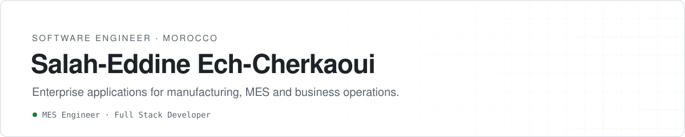

<picture>
  <source media="(prefers-color-scheme: dark)" srcset="assets/header-dark.svg">
  
</picture>

 

I build enterprise web applications for industrial environments. As an **MES Engineer at
Gotion Power Morocco**, I design and deliver the software around production on a battery
manufacturing site: shop-floor request intake, workforce attendance, process monitoring
and document workflows. Before that, I was a **Full Stack Developer Intern at Yazaki
Morocco**, where I built the site's occupational-health management application.

I hold a State Engineer degree in Computer Science and Networks (MIAGE track) from
**EMSI — École Marocaine des Sciences de l'Ingénieur**, class of 2026.

## How I work

- **Process first.** I start from how people on the floor actually work, and write the
  requirements and architecture decisions down before the code.
- **Database under version control.** Schemas evolve through migrations, and integration
  tests run against the real database engine rather than mocks.
- **Deliverable, not just runnable.** Applications ship as containers with documented
  installation, configuration, backup and restore.
- **Built for multilingual teams.** Industrial sites mix French, English, Arabic and
  Chinese, so interfaces are translated from day one, right-to-left included.

## Professional work

These are internal applications, so their source code is not public.

**Gotion Power Morocco — MES Engineer**

| Application | What it does | Stack |
|---|---|---|
| MES Demand Hub | Shop-floor terminals capture MES improvement requests; requests are tracked through their lifecycle and summarised in a monthly report. Four languages. | Spring Boot 4 · Thymeleaf · PostgreSQL · Docker |
| Team Attendance & Overtime | Daily attendance, shifts, overtime, absences and sick leave, with approval workflows, period closure and reporting. French, English and Chinese. | Spring Boot 3.5 · Angular · PrimeNG · PostgreSQL |
| Coating Process Dashboard | SPC monitoring of electrode coating (surface density, control limits, side-to-side comparison), currently driven by a configurable process simulator ahead of MES integration. | Spring Boot 3 · Angular · ECharts · MySQL |
| Document Translation Platform | Translates DOCX and XLSX documents between Arabic, French, English and Chinese on self-hosted models, preserving layout, enforcing a business glossary and protecting numbers and codes. | Spring Boot 4 · Angular · Python / FastAPI · PostgreSQL |

**Yazaki Morocco — Full Stack Developer Intern**

| Application | What it does | Stack |
|---|---|---|
| Occupational Health Management | Employee medical records, medical visits, workplace accidents, workstation adaptations, medication stock and role-based dashboards for doctors, nurses and HR, with an audit log. | Laravel 10 · PHP 8 · Blade · MySQL |

## Public projects

| Project | Description |
|---|---|
| [**Smart Clinique**](https://github.com/echerkaoui1/Application-De-Gestion-Hospitaliere) | Hospital management back end as Spring Boot microservices: Config Server, Eureka, Gateway, OpenFeign, Kafka and WebSocket notifications, one database per service. |
| [**DELTIXIA**](https://github.com/echerkaoui1/deltixia) | Website of DELTIXIA, my digitalization studio — static, four languages including right-to-left Arabic, custom i18n engine. Live at [deltixia.com](https://deltixia.com). |

## Technologies

**Backend**&nbsp;

**Frontend**&nbsp;

**Databases**&nbsp;

**Tools**&nbsp;

## Interests

Manufacturing Execution Systems · industrial digitalization · ERP integration ·
software architecture · enterprise application development

## Contact

[salah.eddinec186@gmail.com](mailto:salah.eddinec186@gmail.com) ·
[Portfolio](https://portfolio-wine-sigma-36.vercel.app) ·
[deltixia.com](https://deltixia.com)
